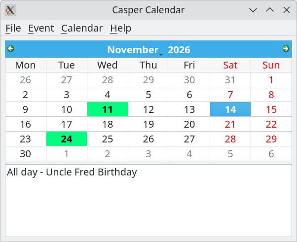
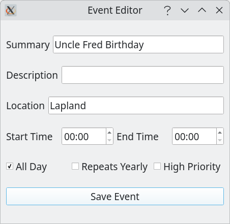
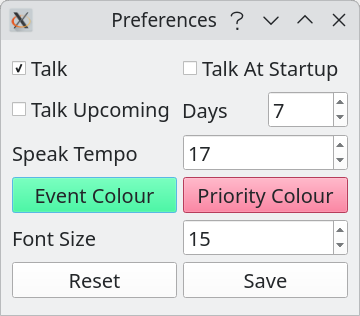
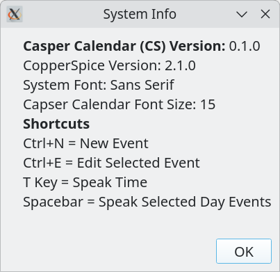

# Casper Calendar (CopperSpice)

Casper Calendar is a talking desktop calendar built with [CopperSpice](https://www.copperspice.com/) and is a port of my Qt [Talk Calendar](https://github.com/crispinprojects/talkcalendar) project. I was intrigued to discover that **CopperSpice 2.1**  now has [Wayland](https://www.copperspice.com/docs/cs_overview/unix-wayland.html) support and this repository documents how I developed a native CopperSpice application on Debian 13 under Wayland


A screenshot of Casper Calendar  is shown below. 



Casper Calendar is a different project to Talk Calendar as CopperSpice is a distinct framework and not a drop-in Qt replacement. This alternative  project is to learn how to develop a CopperSpice application running on Wayland. In my opinion the fact that CopperSpice now supports Wayland is impressive.

## Core Features

* built with C++ & CopperSpice 2.1
* month-view calendar
* export and import iCalendar files (backup and restore)
* built-in speech synthesizer
* Sqlite3 database used to store events

## Self Contained Deployment

I have packaged the compiled Casper Calendar executable with the CopperSpice shared libraries and  runtime plugins it needs so that you do need to compile the source code if using Debian 13. The zip file in the deployment directory contains the executable, libraries such as `libCSCore.so` and `libCSGUI.so`, and a `platforms/` folder with the needed platform plugins. This self-contained app deployment is specific to Debian 13 Trixie distribution and so if you are using a different OS you will need to compile the source code and link dynamically against a local download of the pre-compiled CopperSpice 2.1 for your system as each target platform has its own binary [download](https://download.copperspice.com/copperspice/binary/cs-2.1/).


##  What is CopperSpice?

[CopperSpice](https://www.copperspice.com/) is an open-source, cross-platform C++ GUI library originally derived as a fork of the Qt 4 framework. Developers choose CopperSpice for a cross-platform C++ framework as it  provides GUI and other libraries such as networking, multimedia, SQL, graphics and XML. CopperSpice is best thought of as a specialized alternative to other toolkits such as GTK and Qt. Its appeal includes modern C++ design, CMake integration, signals/slots and GUI widgets. CopperSpice is released under the GNU Lesser General Public License (LGPL v2.1) and can be downloaded for free with out a corporate login. Some developers choose CopperSpice to avoid dependence on Qt’s licensing and governance and its closer integration with standard C++ containers and algorithms. 

CopperSpice 2.1.0 was [released](https://forum.copperspice.com/viewtopic.php?t=4870) on January 27 2026 and includes a new plugin to support Wayland on all Unix platforms. I was intrigued to discover that CopperSpice now has [Wayland](https://www.copperspice.com/docs/cs_overview/unix-wayland.html) support and this repository documents how I developed a native CopperSpice application using Wayland.

CopperSpice removed the need for Qt’s moc tool, but it still has a meta-object system for features such as signals and slots. It uses CopperSpice specific macros principally `CS_OBJECT` and `CS_SIGNAL` to declare the metadata. 

With CopperSpice you use connect() to wire up an event source to an action:
```
QObject::connect(sender, signal, receiver, action);
```
Here QObject::connect is the static connection function inherited from CopperSpice’s QObject class. 

When sender emits the signal, CopperSpice calls the connected action. The action can be a regular member function or a lambda function which is an unnamed smaller function which is writen inline. As a Rule of thumb, in my code, I connect directly to a member function which represents the action I need. For example:

```
connect(infoAction, &QAction::triggered, this, &MainWindow::information);
```
The & operators take pointers to the signal and method.

The [KDE Free Qt Foundation](https://kde.org/community/whatiskde/kdefreeqtfoundation/) uses Qt 6 to develop KDE software and their Wayland compositor/desktop. However, it is interesting to read on their website that: "_The Foundation has license agreements with Qt Group, Digia and Nokia. The agreements ensure that the Qt will continue to be available as Free Software. Should Qt Group discontinue the development of the Qt Free Edition under the required licenses, then the Foundation has the right to release Qt under a BSD-style license or under other open source licenses. The agreements stay valid in case of a buy-out, a merger or bankruptcy._" I do not know what to make of this statement!

The Qt’s Meta-Object Compiler (moc) is a build-time tool. It reads Qt classes marked with `Q_OBJECT` and generates extra C++ code. That generated code supplies Qt’s runtime metadata for features such as signals and slots, properties, and invoking methods by name. The generated file is compiled and linked with the application program. The official Qt 6 documentation says signals are generated by `moc`. Although there is an open technical investigation within the Qt Company about whether standard C++ reflection could eventually replace or reduce the need for Qt moc,  Qt has not removed `moc` in Qt 6 (current version of Qt). This means that CopperSpice is fundamentally different to Qt as it has switched to a moc-free system. 
 
## What is Wayland?

Wayland is a display system. It is the software layer that lets applications draw windows and send input to and from the computer keyboard and mouse. More precisely it is a protocol that desktop environments and applications use to communicate with a Wayland compositor which is the component that manages windows and presents them on screen. Wayland is already the default in many major Linux desktop setups replacing the older X11 (often called Xorg) display system. 

Examples of Wayland compositors include KWin (KDE Plasma), Mutter (GNOME), Sway (a tiling compositor inspired by i3), Weston (the reference compositor), and labwc (a stacking compositor inspired by Openbox).

On  Debian 13 you can use the command below to check if you are running Wayland.
```
echo $XDG_SESSION_TYPE
```

If it outputs **wayland**, you are using Wayland. If it outputs **x11**, you are using X11.

CopperSpice 2.1 provides Wayland-specific shared libraries. The `libCsWaylandClient2.1.so` provides Wayland client support. The `platforms/CsGuiWayland2.1.so` is the platform plugin `CsGui` loads to use Wayland. Casper Calendar also needs the regular CopperSpice dependencies, such as libCsCore2.1.so and libCsGui2.1.so and libCsSql2.1.so. The shared library libCsSql2.1.so is needed because Casper Calendar uses CopperSpice SQL (CSSql) specically the SQLite driver.


```text
Casper Calendar
   ├── CsCore
   ├── CsGui ── loads one platform plugin
   │              ├── CSGuiWayland2.1.so
   │              └── CSGuiXcb2.1.so
   └── CsSql ── loads database-driver plugins as needed
                  ├── SQLite driver
                  ├── PostgreSQL driver
                  └── MySQL driver
```
In CopperSpice, the XCB platform plugin lets GUI applications use the X11 display system. XCB stands for X protocol C-language Binding.

## Calendar Interface

Casper Calendar uses a month view calendar with a bottom list view to display day events when a day is selected. To create a new event select a day on the calendar and then the "new event" menu item or the shotcut Ctrl+N. To edit an event, select it in day list view and then select the "edit event" menu item or use the shortcut Ctrl_E. Likewise to delete an event select it in the day list view panel and use the "delete event" menu item 

Use the File->Export menu item to export a calendar as an iCalendar file for backup purposes. These typically use the file extension ".ical" or ".ics". The [iCalendar standard](https://icalendar.org/) is an open standard for exchanging calendar and scheduling information between users and computers.  An icalendar file is a plain text file and so can be viewed and modified using a standard text editor. 

If talk is enabled select as day on the calendar and then press the spacebar to read out the events for that selected day. 

Press the T-key to speak the current time.

### New Event




### Preferences



### Information



### Events Database

Events are stored in an [Sqlite](https://www.sqlite.org/index.html) database. SQLite is a small, fast and full-featured SQL database engine written in C. 

### Export and Import iCalendar Files

Casper Calendar allows a personal calendar to be exported as an iCalendar file. These typically use the file extension ".ical" or ".ics". The [iCalendar standard](https://icalendar.org/) is an open standard for exchanging calendar and scheduling information between users and computers.  An icalendar file is a plain text file and so can be modified using a standard text editor. 

You should backup your events by using the File->Export iCal menu item. If you then corrupt your database, you can clear all events and then use the File->Import iCal to restore exported events. 

### Recurring Events

The only recurring event type that is currently supported by Casper Calendar is yearly. This is required for events such as birthdays and anniversaries. 

## Speech Synthesizer 

Capser calendar has a built-in diphone concatenation speech synthesizer. This has been coded from scratch in C++ 17 to read out the date, time and event summary words and has been ported from my Dippo project. More details concerning the development of the speech synthesizer can be found on the [Dippo webpage](https://github.com/crispinprojects/dippo).

## Desktop File

To install Casper Calendar locally copy the  "caspercalendar.desktop" file into in the ***~/.local/share/applications/***  directory. If the applications directory does not exist create it. You will need to modify the desktop file so that it uses your user name and the directory where you install local programs. 

A desktop file has a .desktop extension and provides metadata about an application such as its name, icon, command to execute and other properties. The "talkcalendar.desktop" file is shown below. You need to modify this by using your own user name and directory locations. In this example it is assumed that local applications are installed in a folder called Software (/home/your_user_name/Software). Some people use a folder called "Programs". The Exec variable defines the command to execute when launching an application, in this case, the "caspercalendar" binary executable. The Icon variable specifies the path to the icon file associated with the application. The Path variable specifies that Casper Calendar should use this directory as its working directory and so it is where the calendar database is stored. In a .desktop file, you need to use absolute and full paths.

```
[Desktop Entry]
Version=0.1.0
Type=Application
Name=Casper Calendar 
Comment=Casper Calendar (CopperSpice)
Icon=/home/your_user_name/Software/caspercalendar/casper.png
Exec=/home/your_user_name/Software/caspercalendar/caspercalendar
Path=/home/your_user_name/Software/capercalendar
X-GNOME-UsesNotifications=true
Categories=Office;
MimeType=text/calendar;
StartupNotify=true
Name[en_GB]=CasperCalendar
```

Copy your modified  "caspercalendar.desktop" file to ***~/.local/share/applications/***. To do this you can use your graphical file manager or the terminal command below.

```
cp caspercalendar.desktop /home/your_user_name/.local/share/applications
```

Again change "your_user_name" to your user name. Note that ***.local*** is a hidden directory and you need to tick the "Show Hidden Files" option in the file explorer to display it.

You can now run Capser Calendar Calendar from the system menu. It should be located in the "Office Category". 

You can also copy your modified  "caspercalendar.desktop" to ~/.config/autostart so that Casper Calendar starts up when the computer is switched on.


##  Step-by-Step Compilation and Setup

The Casper Calendar project was configured to link dynamically against a local download of the pre-compiled CopperSpice 2.1 Debian 13 binaries.

### 1. File Tree Structure

The downloaded tarball [copperspice-2.1.0-debian13-x64.tar.bz2](https://download.copperspice.com/copperspice/binary/cs-2.1/) is unpacked locally into a libs directory in your home folder. 

```text
/home/yourusername/libs/copperspice-2.1.0-debian13-x64/
├── bin/
├── include/
└── lib/
    ├── libCsCore2.1.so
    ├── libCsGui2.1.so
    ├── CsGuiXcb2.1.so
    └── CsGuiWayland2.1.so
```

### 2. Code

The source code is found in the code folder in the src directory. Above this are `CMakeLists.txt` and 'compile-and-run.sh' BASH script.


### 3. Build Configuration (`CMakeLists.txt`)

The build configuration instructs the generator to target modern C++20 standard layers while routing linkage straight to CopperSpice targets:

```cmake
cmake_minimum_required(VERSION 3.20)
project(caspercalendar CXX)

set(CMAKE_CXX_STANDARD 20)
set(CMAKE_CXX_STANDARD_REQUIRED ON)

find_package(CopperSpice REQUIRED)

set(SOURCES
    src/main.cpp
    src/mainwindow.cpp
    src/eventeditor.cpp
    src/preferences.cpp
    src/sanitizer.cpp
    src/dictionary.cpp
    src/diphone.cpp
    src/synthesizer.cpp
)

add_executable(caspercalendar ${SOURCES})

target_link_libraries(caspercalendar PRIVATE
    CopperSpice::CsCore
    CopperSpice::CsGui
    CopperSpice::CsSql
)
```
---

##  Scripted Automation Workflow (`compile-and-run.sh`)

Because runtime platform drivers must occupy a localized directory structures neighbourhood relative to the executing binary, this build automation pipeline builds the target, structures a local `platforms/` node, and instructs the system to hook natively into the Wayland graphics pipeline.

```bash

#!/usr/bin/env bash
set -e

# Path to where you extracted the CopperSpice Debian 13 binaries
CS_DIR="/home/yourusername/libs/copperspice-2.1.0-debian13-x64"

# 1. Recreate a clean build directory
if [ -d "build" ]; then
    echo "Removing existing build directory..."
    rm -rf build
fi
echo "Creating new build directory..."
mkdir build
cd build

# 2. Run CMake and compile
echo "Running CMake..."
cmake -DCMAKE_PREFIX_PATH="${CS_DIR}" -DCMAKE_BUILD_TYPE=Release ..
echo "Building project..."
make

# ====================================================================
# DIRECTLY POPULATE THE BUILD DIRECTORY FOR STANDALONE RUNNING
# ====================================================================
echo "Copying runtime libraries into the build directory..."
# Copy core libraries directly into the build root
cp "${CS_DIR}/lib/libCsCore"* .
cp "${CS_DIR}/lib/libCsGui"* .
# core SQL database library (needed)
cp "${CS_DIR}/lib/libCsSql"* .

cp "${CS_DIR}/lib/libCsXcbSupport"* . || true
cp "${CS_DIR}/lib/libCsWaylandClient"* . || true

echo "Setting up local platforms subdirectory..."
mkdir -p platforms
# Copy the window plugins into the required subfolder
cp "${CS_DIR}/lib/CsGuiXcb"* platforms/
cp "${CS_DIR}/lib/CsGuiWayland"* platforms/

# Execute the application natively from the build folder
echo "Executing standalone application under Wayland..."
export LD_LIBRARY_PATH=".:${LD_LIBRARY_PATH}"
export QT_QPA_PLATFORM="wayland"

./caspercalendar
```

### Build on Debian 13 

To build Casper Calendar from source you need install C++ (build essential), the CMake/Ninja packages and the alsa utilities as shown below. 

```
sudo apt update
sudo apt install build-essential cmake ninja-build
sudo apt install alsa-utils
```
Once you have set the path to where you extracted the CopperSpice 2.1 binaries in the compile-and-run.sh script you just need to run the BASH script as shown below.

```bash

./compile-and-run.sh 
```

The Casper Calendar application binary is found in the build directory.

## Deployment

Wayland deployment of Casper Calendar requires these shared libraries.
```
| `File`                         | Role                  
|--------------------------------|-------------------------------------------------------
| `libCsCore2.1.so`              | `Core CopperSpice functionality used by other libraries—foundation classes and utilities.` 
| `libCsGui2.1.so`               | `GUI classes, including widgets such as the calendar. It loads a platform plugin to connect the Casper Calendar to the display system.`
| `libCsSql2.1.so`               | `Database API. Casper Calendar uses CopperSpice SQL classes
| `libCsWaylandClient2.1.so`     | `CopperSpice’s Wayland client support, used by the Wayland platform plugin to communicate with the compositor.` 
| `libCsXcbSupport2.1.so`        | `XCB/X11 support with the XCB platform plugin. ` 
| `platforms/CsGuiWayland2.1.so` | `The Wayland platform plugin that `CsGui` loads when Casper Calendaer is launched using the Wayland backend.` 
| `platforms/CsGuiXcb2.1.so`     | `X11/XCB platform plugin variants.` 
```

The XCB shared library is not what makes the Wayland connection and the XCB plugin is not the backend  when explicitly running Casper Calendar on Wayland.

## License

Distributed under the **GPL-2.0-or-later**.

https://www.gnu.org/licenses/old-licenses/gpl-2.0.html


## Author

* **Alan Crispin** [Github](https://github.com/crispinprojects)


## Project Status

Active.

## Acknowledgements

* [CopperSpice](https://www.copperspice.com/)

* [Pre-compiled CopperSpice 2.1 Debian 13 binaries](https://download.copperspice.com/copperspice/binary/cs-2.1/)

* Acoustic Data: Uses the public base [diphone collection](https://github.com/hypnaceae/DiphoneSynth/blob/master/diphones_license.txt) compiled by Professor Alan W Black and Kevin Lenzo.

* Diphone collection and synthesis Alan W. Black and Kevin Lenzo [2000](https://www.cs.cmu.edu/~awb/papers/ICSLP2000_diphone.pdf)

* [Speech Synthesis](https://www.youtube.com/watch?v=eDjtEsOvouM&t=1459s) CMU Low resource NLP Bootcamp 2020  *Author:* Professor Alan W Black 

* Development managed using the [Kate](https://apps.kde.org/en-gb/kate/) source code editor

* [Talk Calendar Qt project](https://github.com/crispinprojects/talkcalendar)


